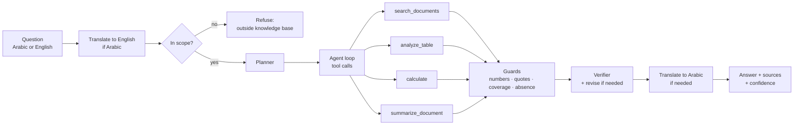

# 🇪🇬 Egypt Economy Analyst — Agentic RAG

An **agentic RAG** assistant that answers questions about Egypt's economy using World Bank and IMF reports plus World Bank indicator tables. Ask in **English or Arabic**; every answer is grounded in retrieved evidence, cited, checked by code-based guards, and verified by a second model.

> **Why "agentic"?** The model does not just retrieve and answer. A planner decides which tools to use, the agent calls them step by step (search reports, query tables, calculate), and a set of guards plus a verifier check the answer before you see it.

---

## ✨ Features

| | |
|---|---|
| 🔎 **Hybrid retrieval** | Vector search (ChromaDB, ONNX MiniLM, no PyTorch) merged with BM25 keyword search |
| 🧭 **Planner** | Picks the right tools and keeps tool calls to a minimum |
| 🛠️ **Four tools** | `search_documents`, `analyze_table`, `calculate`, `summarize_document` |
| 🛡️ **Code-based guards** | Numbers must come from tool results, quotes must appear verbatim, report coverage is enforced, and "not found" claims trigger another search |
| ✅ **Verifier + confidence** | A second LLM checks the answer against the evidence; a confidence label (High / Medium / Low) is shown |
| 🌍 **Arabic layer** | Arabic question → English → agent → Arabic answer, with the English answer one click away |
| 📊 **Data Explorer** | Browse the WDI indicators for any country in the same app |

---

## 🧠 How it works



**Guards in detail**

- **Numbers:** every figure in the answer must appear in a tool result or be computed with `calculate`.
- **Quotes:** quoted text must appear verbatim in the retrieved passages.
- **Coverage:** the World Bank reports end in 2022, so they are never cited for later years. Questions about 2023+ are answered from the IMF report or declined.
- **Absence:** before the agent says something is "not in the documents", it must search again with different wording.

---

## 📚 Knowledge base

| Source | Type |
|---|---|
| World Bank, *Egypt Economic Monitor* (December 2021) | PDF report |
| World Bank, *Egypt Economic Monitor* (December 2022) | PDF report |
| IMF *Country Report No. 25/186* (July 2025) | PDF report |
| World Bank WDI: GDP growth, inflation, unemployment, GDP (current US$), population | 5 CSV files |

The Dec 2019 and Dec 2020 monitors are scanned images with no text layer, so they were excluded.

---

## 🚀 Quick start

### 1. Clone and install

```bash
git clone https://github.com/<your-username>/<your-repo>.git
cd <your-repo>

python -m venv .venv
source .venv/bin/activate        # Windows: .venv\Scripts\activate
pip install -r requirements.txt
```

### 2. Add the report PDFs

The PDFs are **not included** in this repository. Download them from the World Bank and IMF websites and place them in `reports/` with exactly these names:

```
reports/
├── egypt_economic_monitor_dec_2021.pdf
├── egypt_economic_monitor_dec_2022.pdf
└── imf_egypt_country_report_25_186_jul_2025.pdf
```

The indicator CSVs are already in `data/`.

### 3. Configure your API key

Get a free key from [Groq](https://console.groq.com), then:

```bash
cp .env.example .env             # Windows: copy .env.example .env
```

```env
GROQ_API_KEY=your_key_here
GROQ_TPM_LIMIT=                  # optional: tokens-per-minute limit of your plan
```

> Never commit `.env`. It is listed in `.gitignore`.

### 4. Run

```bash
streamlit run app.py
```

The first run builds the vector index (about 1,100 chunks) and stores it in `chroma_db/`. Later runs reuse it.

---

## 💬 Example questions

**English**
- *What was Egypt's inflation in 2023 compared with 2020, and how many times higher was it?*
- *Rank Egypt, Turkey, Morocco and Jordan by population in 2024.*
- *According to the World Bank's December 2022 monitor, what caused inflation to accelerate in 2022?*

**Arabic**
- *ما هي توصيات صندوق النقد الدولي بشأن سعر الصرف في مصر؟*
- *ما هو معدل نمو الاقتصاد المصري في عام 2023؟*

**Out of scope (refused by design)**
- *Who won the 2018 FIFA World Cup?*

---

## 📏 Evaluation

14 questions, run once: 5 numeric, 5 text, 2 multi-source, 2 refusal. Models: `qwen/qwen3.8-27b` (agent) and `openai/gpt-oss-20b` (planner, verifier, translation), both via Groq.

| Category | Questions | Keyword check | Avg tokens | Avg time |
|---|---|---|---|---|
| Numeric | 5 | 5 / 5 | 6,636 | 17 s |
| Text | 5 | 5 / 5 | 8,904 | 31 s |
| Multi-source | 2 | 2 / 2 | 11,298 | 45 s |
| Refusal | 2 | 2 / 2 | 11,351 | 62 s |
| **Total** | **14** | **14 / 14** | **122,995 total** | |

**Read these numbers carefully**

- The keyword check only looks for expected terms. It is **not** a correctness score. Answers were also read manually against the expected values.
- The verifier passed all text and multi-source questions except **R1** (a refusal question), which it flagged after two guard rounds. The answer correctly says the World Bank reports end in 2022 and attributes 2023 to the IMF, but the verifier was not fully satisfied.
- Numeric questions answered from tables are not sent to the verifier. They rely on the code-based number guard instead.
- <!-- TODO: add the T3 re-run result here (an early run leaked reasoning text into the answer; fixed in normalize_citations). -->
- The refusal question R2 is rejected by a keyword scope check, so it costs zero tokens.
- The small eval set (14 questions) and the lack of human-labelled ground truth mean these results show the system works, not how it generalises.

Run it yourself:

```python
from agent_backend import run_eval, show_results
run_eval()
show_results()
```

Results are saved to `eval_results.csv` and the run resumes from that file if it is interrupted.

---

## ⚠️ Limitations

- **Coverage:** the World Bank reports end in 2022. Anything later comes from the IMF report or is declined. Only three report PDFs are indexed, so answers about other periods or topics can be incomplete.
- **Fiscal vs calendar years:** IMF figures use fiscal years (FY2023/24 = Jul 2023–Jun 2024); WDI uses calendar years. Comparisons across them need care.
- **Arabic:** answers are LLM translations of the English answer and can lose nuance or contain small spelling errors. The English answer is always available in the app.
- **Free-tier limits:** Groq's free plan has daily and per-minute token limits. One question costs roughly 5,000–15,000 tokens, so responses can be slow or interrupted.
- **Single user:** the agent keeps global state, so the app supports one user at a time.
- **Not financial advice.** Always check the cited original reports for official figures.

---

## 🗂️ Project structure

```
.
├── app.py               # Streamlit UI (chat, data explorer, about)
├── agent_backend.py     # Retrieval, tools, planner, guards, verifier, agent loop, Arabic layer, eval
├── data/                # 5 WDI indicator CSVs
├── reports/             # PDFs go here (not committed)
├── chroma_db/           # Vector index (generated, not committed)
├── requirements.txt
├── .env.example
└── README.md
```

---

## 🧰 Tech stack

Python · Streamlit · ChromaDB (ONNX embeddings) · rank-bm25 · pypdf · LangChain text splitters · Groq API · pandas

---

## 📄 Data and licenses

The reports and indicator data belong to the World Bank and the IMF. Check their terms of use before redistributing. The code in this repository is provided for educational and portfolio purposes.

---

## 👤 Author

**Asaf** — project 4 of 5 in a hands-on AI engineering series.
[LinkedIn](www.linkedin.com/in/asaf-esmat-557004357) · [GitHub](https://github.com/asafesmat) . [Kaggle](https://www.kaggle.com/asafesmat)
